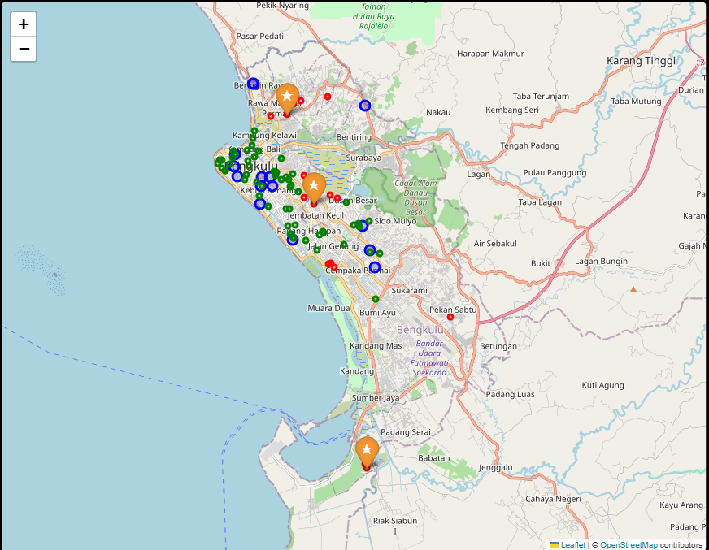

# Open-Source Spatial Analysis: Health-Facility Access & Candidate Site Selection

Case study for the _Informatics Practitioner Lecture Series_ session
"Career and Competition in Industrial Era with GIS" (Universitas Bengkulu).

## Idea from the lecture

Informatics graduates add value to GIS through **programming, data handling and automation**, using **open data** and **open-source tools** instead of manual, siloed workflows.
This project automates a typical GIS-analyst task end to end with Python: open data -> spatial analysis -> decision-support map.

## Question

Which schools (a proxy for community locations) are farther than R metres from the nearest hospital/clinic, and where would **k new facilities** reach the most uncovered schools?

## Pipeline

| Step                                             | Module              | Output                      |
| ------------------------------------------------ | ------------------- | --------------------------- |
| Fetch open data (OpenStreetMap via Overpass API) | `src/fetch_data.py` | `data/raw/*.geojson`        |
| Project to metric CRS, nearest-facility distance | `src/analyze.py`    | `results/school_access.csv` |
| Maximum-coverage site selection (greedy)         | `src/analyze.py`    | `results/summary.json`      |
| Interactive map                                  | `src/analyze.py`    | `results/map.html`          |

## Run

To view the interactive map, serve it locally (opening the file directly makes the map tiles get blocked):

```bash
   cd results
   python -m http.server 8000
   # then open http://localhost:8000/map.html
```

`python -m src.demo_data` writes **random synthetic points** to test the pipeline offline. Never use it for reporting.

## Results

Data: OpenStreetMap extract fetched on 20 Oct 2026 for the study bounding box: 15 health facilities (hospitals and clinics) and 77 schools.
Distances are straight-line; schools are used as demand points. The mean distance from a school to its nearest health facility is about 1.27 km.

Coverage was computed for three access radii (the radius is an assumption, not an official standard):

| Radius | Schools covered before | Not covered | Facilities suggested | Coverage after |
| ------ | ---------------------- | ----------- | -------------------- | -------------- |
| 1000 m | 57.1% (44/77)          | 33          | 3                    | 79.2% (61/77)  |
| 1500 m | 76.6% (59/77)          | 18          | 3                    | 93.5% (72/77)  |
| 3000 m | 94.8% (73/77)          | 4           | 2                    | 100%           |



The map above uses the 1500 m scenario (green: covered school, red: not covered, blue: existing facility, orange star: suggested site).

Findings:

- Coverage is very sensitive to the radius: from 57% at 1 km to about 95% at 3 km, so conclusions depend strongly on what access distance is considered acceptable.
- At 1000 m, three new facilities raise coverage from 57.1% to 79.2%, but 16 schools remain uncovered, so three sites are not enough at this radius; each extra site adds less than the previous one.
- At 3000 m only 4 schools are uncovered, and two suggested sites are enough to reach 100%, so the greedy selection stops before using all three.

Suggested sites come from a greedy maximum-coverage selection restricted to existing school locations (a new facility is assumed to be placed at a school). They are candidates for further study, not planning recommendations.
OSM completeness for this area was not verified; missing facilities or schools would bias these figures.

## Limitations (important)

- Distances are **straight-line**, not road-network travel time.
- Schools are only a **proxy for population**; no census data is used. Results indicate a method, not a verified planning recommendation.
- OpenStreetMap completeness varies; missing facilities make coverage look worse than reality.
- The greedy algorithm is not guaranteed optimal.
- The bounding box and the 3 km radius are assumptions; check the box on a map. UTM 48S (EPSG:32748) is used for metres, verify it suits your study area.

## Possible extension (from the lecture)

Store layers in PostgreSQL/PostGIS and publish the map as a web app. Not implemented here.

Data: (c) OpenStreetMap contributors, ODbL.
